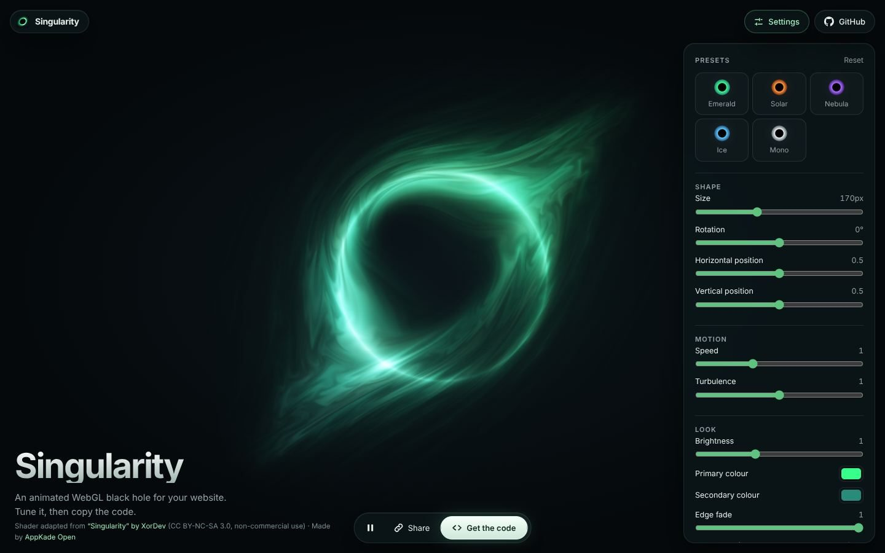

<div align="center">


# Singularity

**An animated WebGL black hole for the web.**

Drop a living, swirling black hole behind your hero section. Tune it in the playground, copy the code, done. Zero dependencies, one file. Based on XorDev's "Singularity" shader.

[](https://github.com/AppKade/singularity/actions/workflows/pages.yml)
[](LICENSE)
[](LICENSE)
[](singularity.js)
[](#-contributing)

[**Open the playground**](https://appkade.github.io/singularity/) · [**Report a bug**](https://github.com/AppKade/singularity/issues/new) · [**Suggest an idea**](https://github.com/AppKade/singularity/issues/new)

<br />

<a href="https://appkade.github.io/singularity/">
  
</a>

</div>

## ✨ Features

- 🌌 **Mesmerising look.** A glowing ring with swirling, spiralling wisps, built on XorDev's "Singularity" shader.
- 🎛️ **Fully tunable.** Size, rotation, position, speed, turbulence, brightness, two colours and an edge fade that blends it into your page.
- 📋 **Copy and paste.** The playground writes HTML, React or fully self-contained code for your exact settings, and every setup has a shareable link.
- 🤖 **Agent-ready.** Prefer an AI coding agent? Copy the **Agent prompt** tab and paste it into Claude Code, Cursor, Copilot or similar; it tells the agent exactly how to add the effect with your settings.
- 🪶 **Tiny and dependency-free.** One ES module, plain WebGL 1, no build step.
- ♿ **Respectful.** Shows a still frame for `prefers-reduced-motion`, and pauses when the canvas is off-screen or the tab is hidden.
- 🔋 **Efficient.** Renders below device resolution by default (the effect is soft, so it looks the same) and has a `quality` knob.

## 🚀 Quick start

The fastest way: open the [playground](https://appkade.github.io/singularity/), pick a look and press **Copy code**.

Or by hand:

```html
<canvas id="singularity" style="width: 100%; height: 480px"></canvas>

<script type="module">
  import { createSingularity } from "https://appkade.github.io/singularity/singularity.js";

  createSingularity(document.getElementById("singularity"), {
    size: 170,
    primary: "#38ff8c",
    secondary: "#298c7a",
  });
</script>
```

Size the canvas with CSS; the drawing buffer follows it automatically. The canvas is transparent, so whatever is behind it shows through the empty space.

### React

Download [`singularity.js`](singularity.js) into your project, then:

```jsx
import { useEffect, useRef } from "react";
import { createSingularity } from "./singularity.js";

export function Singularity({ options, style, ...props }) {
  const canvas = useRef(null);

  useEffect(() => {
    const effect = createSingularity(canvas.current, options);
    return () => effect.destroy();
  }, []);

  return <canvas ref={canvas} style={{ width: "100%", height: 480, ...style }} {...props} />;
}
```

## 🎛️ Options

| Option | Default | Description |
| :-- | :-- | :-- |
| `size` | `170` | Radius of the bright ring, in CSS pixels. The wisps reach roughly 2× further. |
| `x` | `0.5` | Horizontal centre, as a fraction of the canvas width. |
| `y` | `0.5` | Vertical centre, as a fraction of the canvas height (from the top). |
| `rotation` | `0` | Rotation of the whole effect, in degrees. |
| `speed` | `1` | Swirl speed; `0` freezes the motion. |
| `turbulence` | `1` | Strength of the swirling waves, from `0` to `2`. |
| `brightness` | `1` | Overall exposure, from `0.1` to `3`. |
| `primary` | `"#38ff8c"` | Colour of the bright side of the disc. |
| `secondary` | `"#298c7a"` | Colour of the dimmer side of the disc. |
| `fade` | `1` | Soft fade towards the edges: `0` is none, `1` blends into the page. |
| `quality` | `0.75` | Render scale relative to device pixels. Lower is faster. |
| `respectReducedMotion` | `true` | Show a still frame when the visitor prefers reduced motion. |

## 🧩 API

`createSingularity(canvas, options)` returns a controller:

| Member | Description |
| :-- | :-- |
| `set(options)` | Merge new options into the running effect. |
| `options` | The current, normalised options. |
| `pause()` / `play()` | Stop or resume the animation (a still frame stays visible). |
| `destroy()` | Stop rendering, remove observers and release the WebGL context. |

It throws if WebGL is unavailable, so wrap it in `try` if you need a fallback.

## 🛠️ Development

There's no build step. Serve the folder and open it in a browser:

```sh
git clone https://github.com/AppKade/singularity.git
cd singularity
npm start        # python3 -m http.server 8080
npm test         # node --test
```

| Path | What lives there |
| :-- | :-- |
| `singularity.js` | The component: shader, options and controller (CC BY-NC-SA 3.0). |
| `index.html`, `playground/` | The full-screen playground deployed to GitHub Pages. |
| `tests/` | Unit tests for option handling. |
| `.github/workflows/pages.yml` | Tests every PR and deploys `main` to GitHub Pages. |

## 🤝 Contributing

Contributions are welcome: new presets, framework examples, docs and bug fixes. Open an issue first for large changes, keep each pull request focused, and run `npm test` before you submit. For visual changes, include before-and-after screenshots.

Singularity is an [AppKade Open](https://open.appkade.lk) project.

## 📄 License

- **`singularity.js`** adapts [“Singularity” by XorDev](https://www.shadertoy.com/view/3csSWB) and is licensed [CC BY-NC-SA 3.0](https://creativecommons.org/licenses/by-nc-sa/3.0/): credit XorDev and this project, **non-commercial use only**, and share adaptations under the same license.
- **The playground, tests and docs** are [MIT](LICENSE) © AppKade.

Thanks to [XorDev](https://www.shadertoy.com/user/Xor) for the original shader.

<div align="center">
<br />
<sub>If Singularity makes your page look better, consider giving it a ⭐</sub>
</div>
